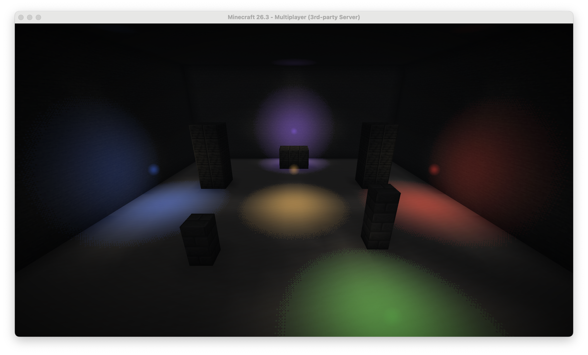
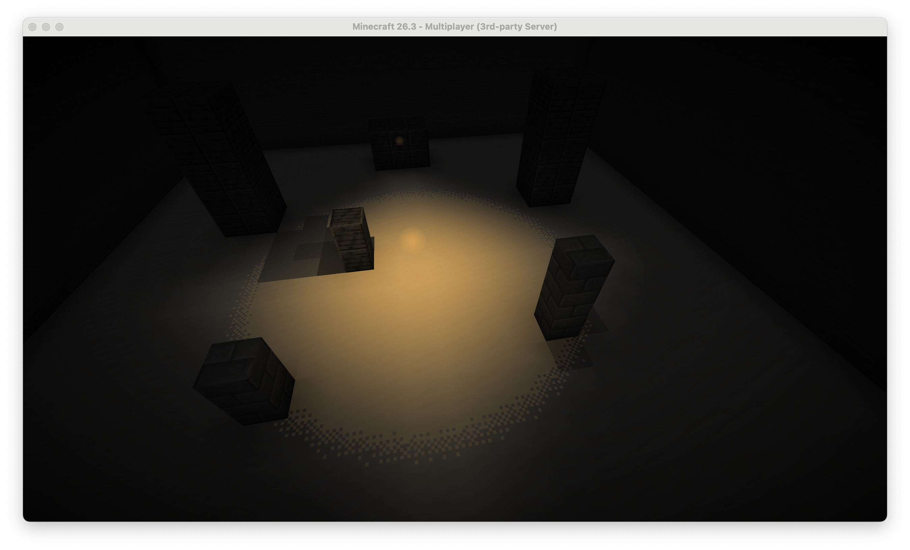
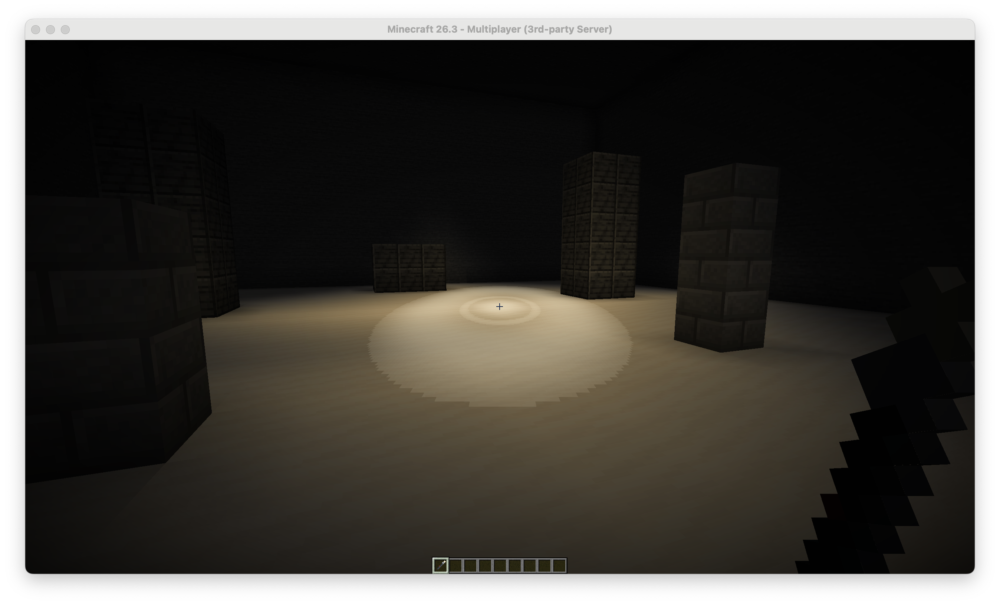
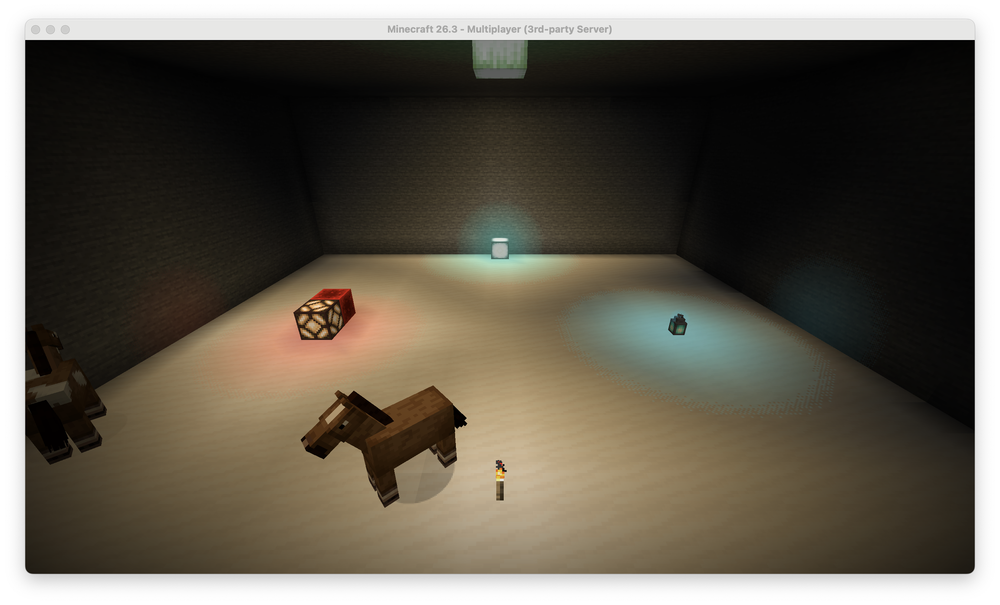
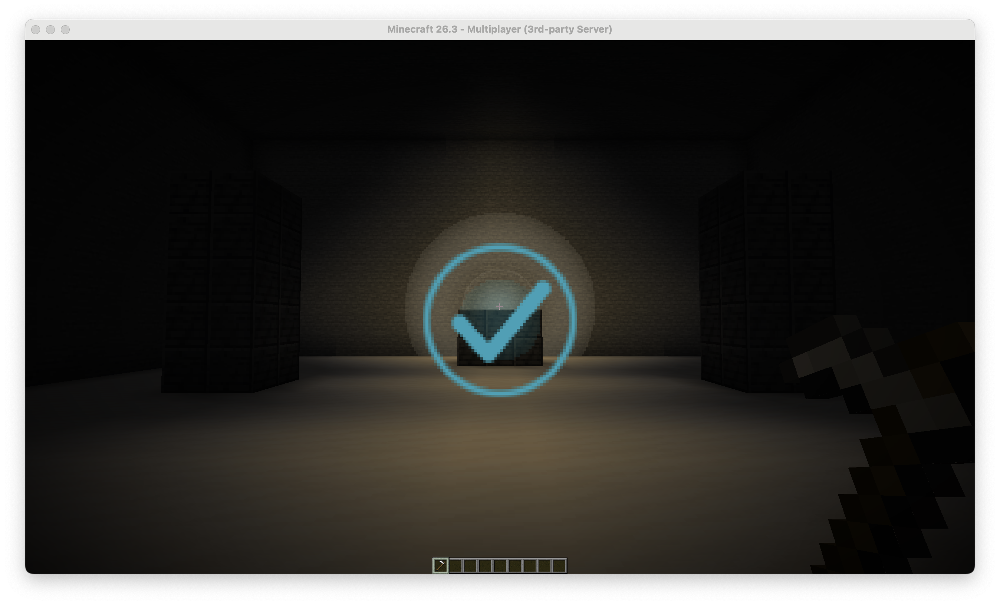

# Lighting

Coloured lights with shadows, flashlights and the **Lighting Wand** for vanilla Minecraft clients, **without shaders
or post effects**.
Paper 26.2+ plugin (one jar), resource pack formats 88–97 (26.2 and 26.3).



## Why 0.1/0.2 failed, and what 0.3+ does instead

0.1 and 0.2 drew colour with a **core shader** (`core/item.vsh`) plus a **per-player post effect**. That chain
breaks in several independent ways on a real server:

1. **The colour pass needs Minecraft 26.3.** `Player.postEffects()` doesn't exist on 26.2, so a 26.2 server or
   client shows only white vanilla light.
2. **The pack never arrived.** 0.1 served the pack on port 8165; a host that only opens the Minecraft port means
   no client ever downloads it, and so no colour (0.2 moved the download onto the Minecraft port).
3. **Shaders are fragile in the combined server pack.** Another pack that overrides `core/item`, a change to the
   shader pipeline, or a client-side shader pack silently removes the effect. Clients reject the whole pack if a
   shader fails to compile (seen before in Firearms 0.27).
4. **Post effects are shared state.** CCTV and Firearms also set per-player post effects.

0.3 removes all of that: **no `.vsh`/`.fsh`, no post effects.** Problems found and fixed on a real 26.3 client
while building 0.3/0.4: decal textures outside `textures/item/` render as missing-texture squares; translucent
items drop pixels under 10% alpha (hard edges, fixed with a dithered fringe); decals bigger than a small block's face
hang in the air as sheets (clamped to the surface's extent, for pools and flashlight spots); block lights hitting
their own block (projection starts at the edge of their cell); `/fill` and WorldEdit fire no events (periodic
rescan); and the separate teleport + metadata packets of moving server entities (0.4: packet entities, position
in the matrix, one bundle per pass). Light is drawn with what the vanilla renderer
already does well:

```
 sources (each tick, shared)               RenderEngine (per player)                 client
 ───────────────────────────               ─────────────────────────                 ──────
 WandLights     lights.yml        ┐        cull: distance + view cone
 BlockEmitters  scanned blocks    ├─► Emitter list ─► rank, cap at preset ─► Projector ─► Decals ─► ViewerState
 HeldLights     hands / helmet    │        (8/16/32)            raycasts → surface        pool of ItemDisplays
 Flashlights    look raycast      ┘                             patches, ellipses        only this player sees
                (+ Firearms hook)                                                        + fake LIGHT blocks
```

* **Colour** = soft decals: a flat item model with a white alpha-gradient texture, tinted per instance with the
  `dyed_color` component (item model tint `minecraft:dye`), full-bright, in 8 opacity steps (custom model data).
  The `Projector` raycasts from each light in the six axis directions and lays a decal flush on every surface it
  hits (2 mm lift against z-fighting). Its size is the light's sphere cut by that surface (`2·√(r² − d²)`), and it
  is clamped so it never hangs off an edge into open air.
* **Brightness** = vanilla LIGHT blocks: real blocks for wand lights (config `lights.light-block: real`), or
  client-side fake blocks (`sendMultiBlockChange`) for held items, flashlights and `packet` wand lights. Fake
  blocks only go into air or water, and the real block is restored when the light moves.
* **Shadows** (0.4): every block cell of a lit surface checks its line of sight to the light, with one ray from the
  centre and four from the corners where neighbouring cells disagree (soft quarter-step edges). Blocked cells merge
  into rectangles that get black decals, weighted by how much light would have reached them. Shadows are block
  resolution, like vanilla smooth lighting. Point-light shadows are cached with the projection and redone when blocks
  change nearby; flashlight shadows are recomputed every pass (`shadows.*` in config.yml).
* **Per player, packet-only** (0.4, `DisplayEntityPoolManager` + `PacketDisplays`): decals are client-only
  item_displays made of packets. They're never in the world, never ticked or tracked by the server, and only their
  viewer sees them. That makes quality presets, colour-vision palettes and the on/off switch per player. A decal keeps
  a fixed anchor and carries its position in the transformation matrix, so moving it (a flashlight following the
  aim) is one interpolated metadata change, with no teleport packet that could arrive in a different frame. Each
  pass's spawns, updates and removes go out as one `ClientboundBundlePacket`. Freed entities stay spawned with no
  item and are reused. If the server's classes ever don't match the reflection, hidden real entities are used
  instead (`/lighting diagnose` says which).



## Flashlights

`FlashlightEngine` raycasts along the look vector up to `flashlights.max-distance` (25). At the hit point a **hotspot** decal (bright core,
faint lens ring) and a **spill** ring lie flush on the surface. Their radius is `d · tan(θ)` (hotspot θ = cone/4,
spill θ = cone/2). Both are stretched by `1 / cos(α)` along the beam's direction on the surface (α = incidence,
capped at 2.5×). The transform maps model X to the ellipse's major axis, Y to its minor axis and Z to the normal
(`SurfaceDecalProjector.flat`). Spots are clamped to the surface they land on, so a beam hitting a pillar shows on the
pillar instead of hanging in the air. Blocks inside the cone shadow the hit surface. Fake LIGHT blocks: 9–15 at the hit, then every 5 blocks along the beam. **Ultra** adds a
volumetric beam: four crossed planes with a longitudinal fade, rotated with `Quaternionf.rotationTo(+Z, dir)`.



Sources of a flashlight: `/lighting give flashlight` (hand-held), `/lighting give headlamp` (helmet), or a
**Firearms** gun with a flashlight attachment. **Q** toggles it.

**Firearms hook** (soft-depend, read-only; nothing in Firearms changes). A gun is an item with the PDC string
`firearms:gun` = gun id. It has a flashlight when its id is in `firearms.flashlight-guns` (`"*"` = every gun), or
when the item carries `firearms.flashlight-flag` (default `firearms:flashlight`; byte/int 0 = detached).

## Emissive blocks

Chunks within `blocks.scan-radius-chunks` of players are scanned off the main thread from a `ChunkSnapshot`, with
empty sections skipped. Blocks of one profile inside a 4×4×4 cell merge into one light, so a nether portal is a
few lights, not hundreds. Lit/charged state (redstone lamp, copper bulb, respawn anchor...) is read when rendering.
Block place/break/piston/explosion/ignite events rescan the chunk. Chunks near players are also rescanned every
`blocks.rescan-seconds`, because `/setblock`, `/fill` and WorldEdit fire no events.

**Warm-yellow sources are deliberately not listed** (torch, lantern, glowstone, jack o'lantern, campfire, lava,
fire, candles...): vanilla already lights them correctly. Default profiles: redstone (crimson), soul fire/torch/
lantern/campfire (cyan), sea lantern and conduit (aqua), shroomlight (coral), froglights (amber/green/magenta),
crying obsidian, respawn anchor and portal (purple), amethyst (violet), sculk (cyan), copper bulbs (bronze →
turquoise by oxidation).



## Held and worn lights

Main hand, off hand or helmet: `held.items` (torch, lantern, glowstone... brightness only; soul torch, sea lantern,
froglights... also coloured). Any item can be a light with the PDC string `lighting:light` =
`"#RRGGBB;radius;level"` (or `"none;radius;level"`).

## Quality presets and player settings

| Preset | Lights | Distance | Update | Layers |
|---|---|---|---|---|
| **Low** (fallback) | 0 decals | 32 | 4 ticks | fake LIGHT blocks only (optionally a `●` text glyph per light) |
| **Medium** | 8 | 32 | 4 ticks | surface glow; flashlight hotspot |
| **High** (default) | 16 | 48 | 2 ticks | + halos, flashlight spill |
| **Ultra** | 32 | 64 | 1 tick | + volumetric flashlight beam |

Every value is in `config.yml` under `quality.*`. Lights outside the view cone (`render.frustum-degrees`) are
skipped unless the player stands inside them. Decals below `render.min-alpha` aren't drawn.

`/lighting settings` opens a dialog. The same settings work as commands: `/lighting settings quality ultra`,
`... animations off`, `... palette deuteranopia`, `... enabled off`, `... flashlight off`. They are stored on the
player. **Colour vision** modes (Protanopia, Deuteranopia, Tritanopia: daltonised from the Machado 2009
simulation; High contrast: fully saturated hues) change light colours only for that player. Players **without the
pack are in fallback mode automatically**: brightness only, never a purple-black square.

## The Lighting Wand

| Input | Does |
|---|---|
| Right-click | Place a light, or edit the light you aim at |
| Sneak + scroll | Resize (preview sphere + resize ring) |
| Left-click | Next colour preset |
| Sneak + right-click | Settings: RGB/hex, radius, intensity, animation (none/pulse/flicker/strobe), spotlight + cone, light block |
| Sneak + left-click | Delete the light you aim at |

Spotlights point where you look when you place them. The edit dialog can also re-aim them (**Aim spotlight**).
Lights persist in `plugins/Lighting/lights.yml`.

## Commands

`/lighting settings` · `diagnose [player]` · `give [wand|flashlight|headlamp] [player]` ·
`create <world> <x> <y> <z> <#hex> <radius> [intensity] [animation]` · `list [radius|all]` · `info [id]` ·
`remove [id]` · `tp <id>` · `removeall <world> confirm` · `pack [player]` · `reload`

`settings` and `diagnose` (for yourself) are for everyone; the rest is op (`lighting.admin`).

## Resource pack, priority and troubleshooting

The pack (`resourcepack/`, generated by `tools/gen_pack.py`) contains only the `lighting` namespace and overrides
nothing vanilla:

```
pack.mcmeta                                  pack_format 97, min_format 88, max_format 97
assets/lighting/items/{glow,hotspot,spill,halo,beam}.json   range_dispatch on custom_model_data[0] (opacity 0..7),
                                                            tints: [{type: minecraft:dye}]
assets/lighting/items/{canary,wand,flashlight}.json
assets/lighting/models/item/light/<kind>_<0..7>.json        flat quad (beam: four crossed planes), light_emission 15
assets/lighting/textures/item/light/<kind>_<0..7>.png       white RGB, radial alpha; glow is 256 px, the rest 128 px
```

Textures **must** live under `textures/item/` (or `block/`): only those folders are stitched into the item atlas.
Anywhere else renders as purple-black squares.

**Priority:** the client applies packs top to bottom. A pack listed *above* Lighting that ships any
`assets/lighting/...` file replaces ours. The server pack is offered as an extra pack (Paper multi-pack), so the
player's own packs can still sit above it. Since Lighting owns its namespace, an override can only happen on
purpose or by a copy of an old Lighting pack.

**Delivery:** `pack.delivery: auto` (default) serves the pack on the Minecraft port itself, so there's nothing to
open in a firewall (it doesn't work behind Velocity/Bungee). `http` serves it on port 8165, `url` points at a file
you host, and `none` means it's merged into the server pack (then copy `lighting-pack.zip`'s `assets/lighting`
into that pack). `pack.strict-pack-required: false` (default) never kicks anyone; `true` uses the client's
"required pack" flow.

**Every player is told on join** whether Resource Pack Lighting is active or they are in fallback mode, and how to
enable server resource packs.

**`/lighting diagnose`** shows the pack status the client reported, the mode, the player's settings, active
decals and fake lights, lights in range per source, and the Firearms state. It then places a **canary** decal in
front of the player for 10 s:



| What the player sees | Meaning |
|---|---|
| Cyan ring with a check mark | Pack models and textures work |
| Purple-black squares | Textures missing or overridden (or the pack is broken) |
| A paper sheet, or nothing | `lighting:canary` is overridden, or the pack isn't loaded |

The server can't see what the client renders, so the canary is the honest check.

## Build

`./gradlew build` → `build/libs/lighting-<version>.jar`. `python3 tools/gen_pack.py` regenerates every pack asset
(textures, models, item definitions).
