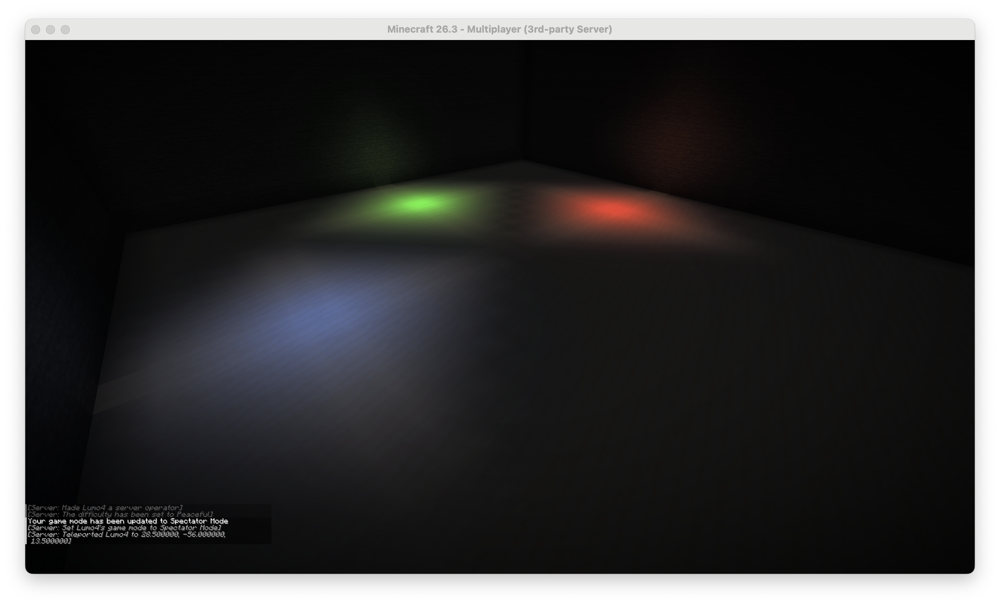

# Lighting

Coloured, shader-lit light sources for vanilla Minecraft clients, placed and edited with the **Lighting Wand**.
Paper 26.2+ plugin (one jar); the colour shading needs **Minecraft 26.3** and the Lighting resource pack.



## How it works

```
 server (plugin)                                client (resource pack)
 ───────────────                                ──────────────────────
 lights.yml ──► LightRegistry ──► per light:
                   │   • LIGHT block (vanilla light, works for everyone)
                   │   • marker: tiny item_display, item lighting:marker
                   │       custom_model_data floats[0] = slot (0..63)      core/item.vsh sees the marker texel
                   │       colors[0] = RGB, colors[1] = (r*8, i*64, 165) ─► moves the quad onto a few pixels of the
                   │                                                       frame and writes position/colour/params
 PackService ──────┼──► pack (http / url / merged)                         (data block, bottom-left corner)
 LightEffect ──────┴──► Player.postEffects() += lighting:colored_lights ─► post pass reads the data block + depth,
                                                                            rebuilds each pixel's position, adds
 WandListener + WandVfx ──► particles, sounds, dialogs                      the coloured light, hides the block
```

* **Markers** are non-persistent `item_display`s spawned when a chunk loads and removed when it unloads. Width and
  height are 0, which turns off client frustum culling, so a light behind you still lights what you see. They are
  scaled to 0.001, so without the pack they are invisible.
* **The item shader** (`lighting_26_3/assets/minecraft/shaders/core/item.*`) checks the texel under each vertex. The
  marker texture has key texels `R 217, G 41, B = kind*64 + slot`. For a marker it computes the view-space centre
  (`ModelViewMat * Position`) and draws a screen-space quad over that light's pixels instead of the item. Every
  other item renders exactly as vanilla.
* **The data block** (see `shaders/include/lightdata.glsl`): row 0 holds the world projection matrix as 16 exact
  floats plus a magic pixel. Rows 1..16 hold 4 lights per row, 5 px each: x, y, z as 24-bit fixed point (±512
  blocks, 0.00006 block steps), the colour, then radius·8 / intensity·64 / magic.
* **The post pass** (`shaders/post/colored_lights.fsh`) rebuilds view position from depth (`inverse(ProjMat)`,
  respecting `RENDERPEARL_DEPTH_IS_ZERO_TO_ONE`) and normals from neighbour depths. It loops over the 64 slots.
  Attenuation is a windowed inverse square `(1-x²)²/(1+6x²)` that reaches 0 exactly at the radius, multiplied by
  wrapped N·L. Output: `scene · hueFilter · (1 + sum·Gain) + sum·Ambient`, with `sum ≤ MaxBoost`. The uniforms
  (Gain 1.6, Ambient 0.10, Wrap 0.35, MaxBoost 2.5, Tint 0.7) are in `post_effect/colored_lights.json`. Cost when
  no markers are on screen: one texel fetch per pixel.

**Limits (by design):** 64 lights per world (the shader's slot count). No shadows: inside its radius, coloured light
passes through walls (the vanilla LIGHT block's real light doesn't). The first-person hand item is drawn after post
effects, so it isn't tinted. On 26.2 there are no per-player post effects, so lights there are vanilla light plus
particles.

## The wand

| Input | Does |
|---|---|
| Right-click | Place a light at the preview point (centre of the air block in front of the aimed face, or 6 blocks out). If you aim at a light: **edit** dialog |
| Sneak + scroll | Resize: ±0.5 blocks per notch (1..24); the hotbar doesn't move |
| Left-click | Next colour preset (config `lights.color.presets`) |
| Sneak + right-click | Settings dialog: R/G/B sliders, hex, radius, intensity, vanilla light block |
| Sneak + left-click | Delete the light you aim at |

The edit dialog has **Save** (recolour/resize), **Move to my aim**, **Copy to wand** and **Delete**. Lights are aimed
at with a ray (12 blocks, 0.6 block tolerance).

## VFX parameters

| Effect | Who sees it | Exact parameters |
|---|---|---|
| Preview sphere | holder | Every 2 ticks: 3 great circles (normals Z, X, (1,1,0)) spinning about Y at 0.02 rad/tick, plus a latitude ring sweeping pole to pole (60-tick sine at 0.95·r). `DUST` in the light colour, size `min(1.1, 0.6 + 0.025·r)`, `clamp(2πr·3, 24, 96)` points per ring. Core: 2 `DUST` size 1.6 plus an `END_ROD` every 4 ticks |
| Resize animation | holder | 10 ticks: an equator ring eases out-cubic from the old to the new radius (2× density, colour 50% toward white, size +0.4) with 6 `ELECTRIC_SPARK`s per frame. `AMETHYST_CLUSTER_HIT`, pitch 0.5→2.0 across min→max radius. Quick scrolls chain from the current ring |
| Light dots | holder | `DUST` size 1.2 at every light within 32 blocks; the aimed light gets its full sphere with a white core |
| Wand trail | everyone ≤ 32 | Each tick at the wand tip (eye + 0.55 forward + 0.38 right − 0.32 up): `DUST` size 0.55, offset 0.04; `WAX_ON` every 6 ticks |
| Swing arc | everyone ≤ 32 | 14 `DUST_COLOR_TRANSITION` (colour → white, 0.9) on a diagonal from upper right to lower left, bowed 1.0–1.3 blocks out; `ELECTRIC_SPARK` every 4th; `TRIDENT_RETURN` 0.25 / 1.9 |
| Placement burst | everyone ≤ 48 | 28 `TRAIL` rays (14 ticks) to a fibonacci sphere at max(1.2, 0.6·r); 24 `FIREWORK` speed 0.18; 12 `GLOW`; a 40-point `DUST` shell over 4 frames (every 2 ticks) out to 0.75·r, fading from white to the light colour and shrinking 1.6 → 0.8. `AMETHYST_BLOCK_CHIME` 1.0/1.3 + `BEACON_POWER_SELECT` 0.5/1.8 |
| Edit applied | everyone ≤ 48 | 60-point `DUST` shell at the new radius, size 1.1; `AMETHYST_BLOCK_RESONATE` 0.8/1.5 |
| Removal | everyone ≤ 48 | 24 `TRAIL`s collapsing from a 1.5-block shell (10 ticks), then 10 `SMOKE`; `BEACON_DEACTIVATE` 0.7/1.6 |

## Storage

`plugins/Lighting/lights.yml`: one entry per light (world uid + name, x/y/z, `#RRGGBB`, radius, intensity,
vanilla-block, owner, created). It's saved 2 s after a change (written off-thread to a temp file, then moved
atomically), and again on shutdown.

## Commands (`/lighting`, alias `/lights`)

`give [player]` · `create <world> <x> <y> <z> <#hex> <radius> [intensity]` · `list [radius|all]` · `info [id]` ·
`remove [id]` · `tp <id>` · `removeall <world> confirm` · `shader [on|off]` (for yourself) · `pack [player]` · `reload`

Permissions: `lighting.wand`, `lighting.command.<sub>`, `lighting.admin` (all). Everything is op-only except
`lighting.command.shader`.

## Pack

Built from `resourcepack/` at startup and served on port 8165 (`pack.delivery: http`), or `url` / `none` (merged).
The base pack (formats 88..97) has the wand and marker models; all shaders live in the 26.3 overlay `lighting_26_3`.
The pack overrides `minecraft:shaders/core/item.vsh/fsh`; changes are between `LIGHTING BEGIN/END` markers, so it
can be merged with another pack's item shader by hand.

## Build

`./gradlew build` → `build/libs/lighting-<version>.jar`. `python3 tools/gen_pack.py` regenerates the marker models,
textures and wand. `python3 tools/validate_shaders.py <glslang> <pack assets>,<vanilla assets> <files> [-D...]`
compiles shaders the way the client does. The 26.3 client compiles to SPIR-V: use `gl_VertexIndex`, and remember
that `filter` is a reserved word.
